<picture>
<source media="(max-width: 600px)" srcset=".github/plate-narrow.svg">

</picture>

# autocto

[](https://github.com/zaidwhy/autocto/actions/workflows/ci.yml)
[](https://pypi.org/project/repo-autocto/)

Where a repository is risky to change is already written in its git history: the files that
change most and branch most are where bugs cluster. autocto ranks that from the history and the
source tree alone, with no LLM, no network and no runtime dependencies, so the same commit gives
the same ranking and every score can be audited line by line.

It is for someone handed an unfamiliar codebase who needs to know which files to read first, and
for a CI step that should fail when one file gets too risky. It reads a repository and prints a
report; it never runs repository code and writes nothing.

```bash
pipx install repo-autocto   # or: pip install repo-autocto
autocto report /path/to/some/repo
```

Needs Python 3.12+ and `git` on the PATH. The PyPI distribution is `repo-autocto`; the command
and the import name are `autocto`.

## Commands

| Command | What it ranks | Signal |
|---|---|---|
| `autocto hotspots [REPO]` | files | churn (commits touching the file) x complexity (branch keyword and operator count) |
| `autocto duplicates [REPO]` | file pairs | token-shingle Jaccard similarity, default threshold 0.6 |
| `autocto maintenance [REPO]` | files | `size x churn x (1 + fan_in)` |
| `autocto architecture [REPO]` | cycles, god files | import cycles, files both large and highly connected; layering violations only with `--layers a,b,c` |
| `autocto report [REPO]` | the four analyzers above | top 5 of each in one pass |
| `autocto plan FILE` | proposed changes | orders a JSON redesign proposal into a dependency-ordered markdown plan |

Every command takes `--json`; the repo defaults to the current directory. `hotspots` and
`maintenance` take `--limit N` and `--fail-over N`: if any file's score (or cost) is above N, the
offending files go to stderr and the command exits 1. It checks every file, not only the rows
shown. Exit 2 means a usage or input error (not a git repository, a malformed proposal).

```bash
autocto hotspots . --fail-over 5000   # CI step: fails the build when a file crosses the line
```

Source walks cover `.py`, `.js`, `.jsx`, `.ts` and `.tsx` and skip `.git`, `node_modules`,
`dist`, `build`, caches, `site-packages` and any virtual environment named `venv*` or `.venv*`.
The analyzers are also importable as pure functions; see [`docs/analyzers.md`](docs/analyzers.md).

## Measured

Captured 2026-11-13 against a local checkout of [recall](https://github.com/zaidwhy/recall)
(227 commits):

```
$ autocto hotspots ../recall --limit 3
path                  churn  complexity  score
--------------------  -----  ----------  -----
frontend/src/App.jsx  41     129         5289
backend/main.py       42     90          3780
backend/memory.py     11     49          539
```

`App.jsx` also tops the maintenance-cost ranking (cost 63304, size 772, fan-in 1). On
autocto's own history the ranking is flat (top file score 335) and `autocto duplicates .` finds
no pair above 0.6. On `personal-llm` the architecture report finds 0 import cycles and 5 god
files, the largest being `memory/store.py` (427 lines, imported by 20 files). Full outputs for
all four analyzers and a migration plan are in [`docs/demos.md`](docs/demos.md).

These runs show that the signals separate files on real repositories. They do not show that the
ranked files are where bugs were fixed; that comparison against a bug history has not been done.

## Architecture

Five analyzer modules over two inputs (`git log --numstat` and the source tree), plus a
stdlib import resolver, a shared directory-skip rule and a thin CLI. Each module is pure
functions plus one `analyze_repo` that does the I/O, and `git` is an injectable seam so tests
never shell out.

| Module | Role |
|---|---|
| `hotspots.py`, `maintenance_cost.py` | read `git log` once each; churn x complexity, size x churn x fan-in |
| `duplicates.py` | shingle every file, compare every pair |
| `architectural_debt.py` | cycles (Tarjan), god files, optional layering check on the import graph |
| `imports.py`, `walk.py` | resolve each import to the one file it names; which directories to skip |
| `migration_plan.py` | Kahn topological sort over human-proposed changes; `CycleError` on a loop |
| `cli.py` | argument parsing, tables, `--json`, exit codes |

Components, data flow, tradeoffs, failure modes and scaling are in
[`docs/ARCHITECTURE.md`](docs/ARCHITECTURE.md).

## Tests

`pytest -q`: 162 passed (run 2026-11-13, Windows 11, Python 3.12). One file per analyzer plus
`test_cli.py`; fixtures build throwaway git repositories with real `git` commands. CI runs
`ruff check .` and `pytest tests/ -q` on Ubuntu with Python 3.12. Install the dev extras first:
`pip install -e ".[dev]"`.

## Status

v0.2.0 (2026-10-14) is on PyPI; the CHANGELOG has one unreleased fix. No known users beyond the
author. Candidate next steps, and what is deliberately not planned (any LLM call, auto-fixing),
are in [`ROADMAP.md`](ROADMAP.md). A metadata-only `autocto` package on PyPI depends on
`repo-autocto` so the short name works with `pip install autocto`.

## Limits

- Complexity is a branch-keyword count, not cyclomatic complexity. It ranks files within one
  repository and should not be compared across repositories.
- Imports the resolver cannot follow (tsconfig path aliases, `sys.path` edits, dynamic Python
  imports, files that do not parse) give no edge, so fan-in and cycles undercount.
- Only Python, JavaScript and TypeScript files are scanned by default.
- Duplicate detection compares every pair, so it grows with the square of the file count.
- Library functions raise `CalledProcessError` outside a git repository; only the CLI turns it
  into a one-line error.

## License

MIT, see [`LICENSE`](LICENSE).

---

<sub>One plate from the survey at [github.com/zaidwhy](https://github.com/zaidwhy). The strip on the plate above is this repository's own commit history, one band per week.</sub>
